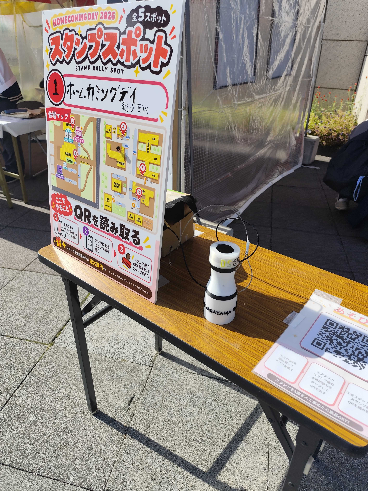
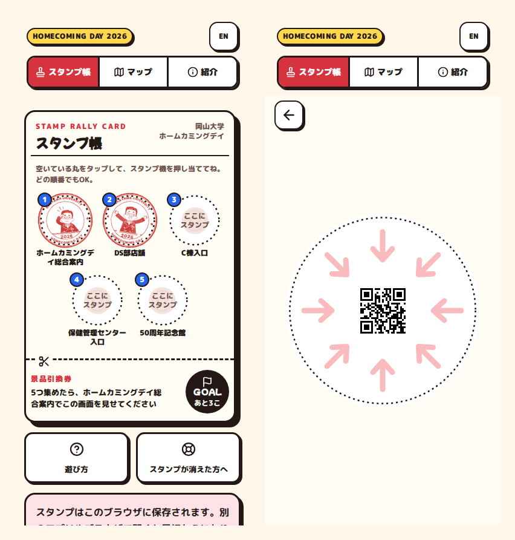
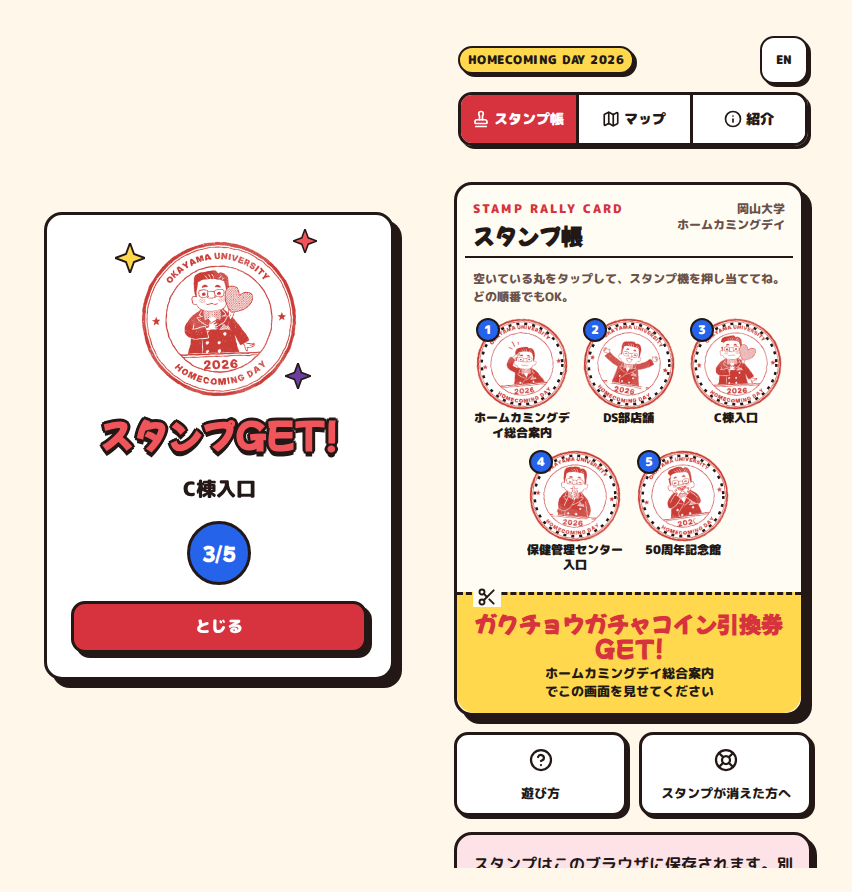
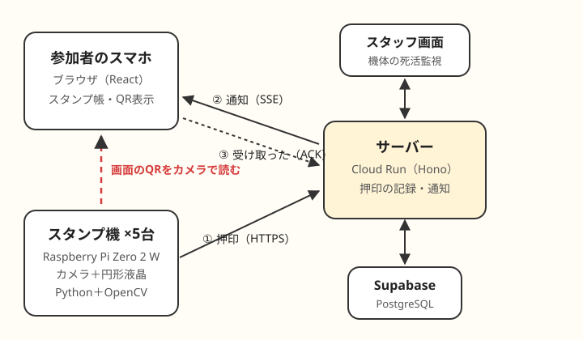
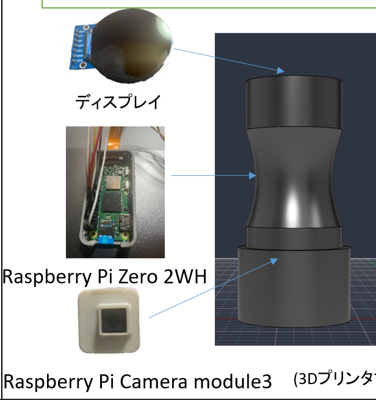

2026年10月31日の岡山大学ホームカミングデイで、デジタルスタンプラリーを作って運営しました。このイベントは、岡山大学の大学祭と同時開催されていて、岡山大学の卒業生を主にターゲットとしたものです。ホームカミングデイをより盛り上げるために、学祭側から学生に来てもらおうという狙いでスタンプラリーを企画しました。

とあるイベントに企画書を提出していて、概要だけならこちらの方が見やすいです。：[スタンプ機概要（PDF）](/images/blog/hcd-stamp-rally/スタンプ機概要.pdf)

このプロダクトを一言で説明すると、専用のWebアプリを用いてスマホをスタンプ帳に見立てて、各スポットにある電子スタンプ機をスマホに押し当てるとアプリ上でスタンプが押される、というものです。当日は約360人が参加して137人が完走し、システムは一度も止まりませんでした。…と言いたいところですが、ログを見返すと裏ではいろいろ起きていました。

この記事では、どう作ったか（AIエージェントの使い方を含む）、当日のデータ、「止まらなかった」の裏側をまとめます。技術寄りの話も出てきますが、わからないところは読み飛ばしても話がつながるように書いたつもりです。



---

## どんなスタンプラリー？

参加者はチラシや掲示のQRからWebアプリを開きます。インストールもログインも要りません。空いている丸をタップするとQRが拡大されるので、それをスタンプ機のカメラにかざします。



読み取りに成功すると、スタンプ機の丸い液晶とスマホの両方でスタンプが落ちてくる演出が出ます。スポットは5か所で順番は自由。5個集めると景品引換券が「ガクチョウガチャコイン引換券GET!」に変わり、総合案内で見せると景品がもらえます。




## しくみ



ポイントは**スマホとスタンプ機が直接通信しない**ことです。スタンプ機はスマホ画面のQRをカメラで読むだけで、あとはサーバーが仲介します。

1. スタンプ機がQRを読み、サーバーへ「この人がこのスポットで押した」と送る
2. サーバーが記録して、その人のスマホへ通知（SSE）を送る
3. スマホが「受け取った」（ACK）と返し、演出を出す

QRの中身は参加者ごとの値で、スポットごとには変えていません。どのスポットかはスタンプ機の側が知っているので、参加者はどの丸をタップしても、実際にかざしたスポットにスタンプが付きます。

データを書き込むのは「スタンプ機→サーバー」の1本だけで、スマホは結果を受け取るだけです。こうしておくと、不正や二重記録を考える場所が1か所で済みます。

スタンプ機は Raspberry Pi Zero 2 W にカメラと240×240の円形液晶をつけたもので、本番用5台と予備1台を用意しました。ネットはスポットごとのポケットWi‑Fiです。

## 技術選定

| 部分 | 採用 | 理由 |
| --- | --- | --- |
| サーバー | TypeScript + Hono（Cloud Run、1台構成） | Webと型を共有できる。SSEの常時接続を数百本さばける |
| Web | React + Vite | サーバーから同じオリジンで配信し、CookieとSSEをそのまま使う |
| API の型 | Zod スキーマを共有 | サーバーとWebの食い違いを型チェックで見つける |
| DB | Supabase（PostgreSQL、無料プラン） | SQLで集計でき、一意制約で二重記録を防げる |
| スタンプ機 | Python + OpenCV | 試作のコードがPythonだった |
| テスト | Vitest、Playwright、pytest、ローカルのPostgreSQL | 本番のサービスを使わずに試験する |

最初はDBをFirestoreにする予定でしたが、仕様を詰める途中でSupabaseに変えました。費用は Cloud Run が10月全体で約1,700円（当日分は約200円）、Supabaseは無料プランで収まりました。Cloud Runは無料クレジットがあったので実質無料でこのプロジェクトは完了しました。

## スタンプ機のハードウェア



電子スタンプ機の構造はこのようになっています。機体の中にRaspberry Pi Cameracableとジャンパワイヤを通しています。
また、機体はFusionを用いて3Dモデリングしたものを3Dプリンターで印刷しています。完全自作のモデルで、本番で使用したモデルには私の所属するDS部のロゴやホームカミングデイを主催する岡山大学Alumniのロゴを入れています。

## AIエージェントとの作り方

開発は9月21日の最初のコミットから当日まで約6週間、コミットは70回です。コードはほぼAIに書いてもらい、僕は仕様を決める・実機で試す・確認する側に回りました。使ったのはClaude CodeとMuse Spark Freeです。

要件定義や仕様書作成、細部の調整などは安心と信頼のClaudeCodeのOpus5.5 Xhighに任せて仕様通りに実装をする部分はCodexのGPT5.6 sol highに投げていました


### 1. 仕様書をでAIを縛る

実装の前に仕様書（docs/spec.md）を作り、AIへの指示書になる AGENTS.md にこう書きました（抜粋）。

```
- 実装と仕様が食い違ったら仕様に従う
- 仕様に書かれていない判断が必要になったら、推測で決めずに作業を止め、選択肢と推奨を添えて質問する
- 仕様書の章番号（例：6-7）を、該当する実装のコメントに書く
- 利用者から仕様・設計・完了条件の変更を明示された場合を除き、docs/spec.md、docs/design.md、docs/goals/ を編集しない
- 完了条件を満たすためにテストを削除したり、期待値を実装に合わせて書き換えたりしない
- Cloud Run など本番環境へのデプロイを実行しない
```

これがかなり効きました。デザインの修正を頼んだときは「`AGENTS.md` に『`docs/design.md` を編集しない』と明記されているため、現状では更新できません」と断られ、修正点を別のファイルに書き出す形になりました。アクセス制限の回数のように仕様にない値は、作業を止めて選択肢を出してくれます。

仕様は v1.0 から v1.18 まで18回改訂しました。変えるときは基本的に「仕様書を先に直す → 実装する」の順で、コードのコメントには仕様の章番号が入っています。あとから「なんでこうなってるんだっけ」を追えるのが助かりました。ただ18回も変更をしなければならなかったのは大きな反省点ですね。最初からもっと詰めていれば時間を節約できたかも。

### 2. 完了条件を渡して一気に作らせる

作業を「サーバー」「Web」「スタンプ機」「結合」の4つに分け、それぞれ完了条件のファイル（docs/goals/）を用意しました。Codex には

```
/goal docs/goals/01-server.md の完了条件をすべて満たす
```

と1行渡すだけです。9月21日の夜、4つが約2時間15分で一通りできあがりました。結合テストでは、カメラのない模擬スタンプ機で「押印 → サーバー停止中は保存 → 復旧後に再送 → 5個目で完走」まで通しています。

### 3. 「終わりました」を信じない

ただ、AIの完了報告をそのまま信じるとハマります。

- サーバー：「完了」の報告だったが、DBを使うテストはスキップされていた
- スタンプ機：完了条件は pytest なのに unittest で書かれていて、聞き返すと「いいえ、厳密には未完了です」

4つ終わった後に別のセッションで「仕様書を見て、実装がすべて終わったか確認してください」と監査させると、仕様との食い違いが6件出てきました。そこで「私の判断が必要なところはありますか？」と聞くと、僕が決めるべき点と、仕様から答えが一つに決まる点を分けてくれます。決めるところだけ決めて、残りは任せる流れが一番楽でした。

### 4. 実機のことは人間の目が勝つ

ハード絡みはAIが観測できないこともあって、AIはわりと自信満々に外します。

- 液晶とカメラの向きは「西から見て」「東から見て」と言葉でやり取りして迷走したので、最後は液晶に0/90/180/270の数字を出して決めました
- セットアップ手順書の抜けで止まったときは、僕の「手順書が間違えてる？」「なんかの実行忘れではないの？」のほうが原因に近かったです

ソフト側はAI丸投げでいい時代ですが、ハード側はまだまだ苦労が多そうです。

### 5. 使い分けと並行作業

- 同じ質問を Codex と Claude Code の両方に投げて比べることもありました（Pi を何台も効率よくセットアップする方法など）
- 並行作業をするタイミングは気を付けましょう。デザインの相談と実装を別々のセッションで同時に進めたら、見開き型のスタンプ帳ができあがった約10分後に、相談側で「台紙型の方がいいじゃん！」となって作り直しになりました。
- 本番デプロイは AGENTS.md で禁止しておき、必要なときだけ「今回に限りデプロイしていいのでやってください」と明示して頼みました

## 工夫したところ

### 押印を失わない

- サーバーはDBの一意制約で「同じ人・同じスポット」を1回しか記録しません。同じQRを何度読んでも二重にならず、2回目以降は液晶の絵柄に緑のチェックマークが付きます
- スタンプ機は送れなかった押印をファイルに保存し、つながったら再送します。再送は10月31日のうちだけで、11月1日になったら捨てます

### 通知は届かなくても大丈夫にする

スマホへの通知（SSE）は、スリープや画面の切り替えで簡単に切れます。そこで仕様にこう書きました。

> SSEの成否に関わらず、10秒間隔で /api/me を常時ポーリングする。失敗検知の分岐は設けず、原因を問わずあらゆる取りこぼしを最大10秒で回収する。

「切れたことを検知して…」と賢くするのではなく、何があっても10秒で追いつく保険です。これが当日まさに効きました（後述）。

### 止まっても自分で直る

- カメラの映像が届かなくなると、メインループが止まったまま固まります。5秒進まなかったらプログラムを自分で終了し、systemd に5秒後に起こし直してもらいます
- スタンプ機は30秒ごとにサーバーへ生存報告（ハートビート）を送り、90秒届かないとスタッフ画面に「断」と出ます。初回の報告をわざと起動30秒後にしているので、再起動を繰り返す機体は「断」として見つかります
- イベント2日前、カメラのケーブルが抜けても「正常」と報告し続ける欠陥が見つかり、直しました
- 予備機は、壊れた機体のIDを名乗って起動し直すだけで差し替えられるようにしました

### 時間で画面を切り替える

10:00の一般開放までは待機画面だけを出し、15:30（景品交換の締め切り）以降は終了画面だけを出しました。終了画面を作るのを忘れていて、当日の14:47に作り始めて、14:55に完成しています。

## 実機でハマったこと

- **デスクトップ版のOSだとカメラが止まる**：電源を入れた直後に毎回映像が止まりました。デスクトップの機能がカメラを探しに行くのとぶつかっていたようで、デスクトップなしの Lite 版にしたら直りました
- **QRの大きさが定まらない**：75px → 64px → 50px と小さくした後、カメラを Module 3 に替えたら近くにピントが合わなくなり、75pxに戻しました。標準の Module 3 は約6.7cmより近くに合いません
- **QRがどっちにあるかわからない**：液晶に映るのはカメラ映像の約5cm四方で、QRを囲む白い円も直径約5cm。少しずれると液晶には白しか映りません。円の中にQRへ向かう矢印を8本描きました
- **地図のピンが13〜30mずれる**：座標の列が単精度（`real`）で、読み出すと丸められていました。倍精度にしてずれは0になりました
- **Wi‑Fiが5GHzだけ**：前日、とある事情で学内Wi‑Fiを使おうとしたら、Pi Zero 2 W は2.4GHzにしかつながらないのに学内Wi‑Fiは5GHz専用でした。前日の夜にポケットWi‑Fiを手配し直しています
- **電源を抜いたら起動しない**：電源をそのまま抜いたせいか、再送キューのファイルが0バイトになり、起動時に読み込めず落ちていました。空のファイルは退避して起動を続けるよう直しました

## 当日の数字

開催は10:00〜16:00の6時間です。

### 参加者

アクセスは472件ありましたが、うち113件は人ではありませんでした。LINE のリンクプレビュー（88件）、iMessage などのプレビュー（10件）、Slack（8件）、古いUAの巡回（7件）です。URLを共有すると、プレビューを作るためにボットがページを開き、そのたびに参加者として数えられていました。これを除くと、

- 参加者：359人
- 1つ以上押した人：242人（67%）
- 完走：137人（参加者の38%、押した人の57%）
- 押印：887回

完走までの時間は中央値36分（最短11分、最長247分）でした。ページを開いてから最初の押印までは中央値0.4分で、ほとんどの人がスタンプ機の前でページを開いています。

### 時間帯とスポット

| 時間 | 押印 | 完走 |
| --- | --- | --- |
| 10時台 | 62 | 1 |
| 11時台 | 219 | 16 |
| 12時台 | 211 | 41 |
| 13時台 | 158 | 29 |
| 14時台 | 193 | 39 |
| 15時台 | 44 | 11 |

一番混んだのは11:34の1分間11回で、同じ機体で2秒おきに押されている場面もありました。

| スポット | 押印 | 最初に訪れた人 |
| --- | --- | --- |
| ホームカミングデイ総合案内 | 215 | 147 |
| DS部店舗 | 169 | 14 |
| C棟入口 | 154 | 14 |
| 保健管理センター入口 | 156 | 12 |
| 50周年記念館 | 193 | 55 |

完走者の回り方は22通りで、一番多いのは「総合案内 → 50周年記念館 → 保健管理センター → C棟 → DS部店舗」の43人でした。総合案内と50周年記念館は押印の間隔が中央値1.8分と近く、2個で止まった人の多くもこの2か所です。

### 速さと端末

- スタンプ機が送ってからサーバーが記録するまで：中央値152ms
- スマホが受け取りを返すまで：中央値168ms
- 端末は iOS の Safari が204人で最多。LINE などのアプリ内ブラウザは7人だけでした
- 同じスポットでもう一度かざした回数は322回。スタンプ機は同じQRを3秒ごとに読み直すので、かざしっぱなしにすると2回目として数えられます

## 「止まらなかった」の裏側

### スタンプ機は84回再起動していた

| 機体 | 再起動 |
| --- | --- |
| dev-01（総合案内） | 17 |
| dev-02（DS部店舗） | 16 |
| dev-03（C棟入口） | 22 |
| dev-04（保健管理センター入口） | 15 |
| dev-05（50周年記念館） | 14 |

5台合わせて84回、プログラムが自動で再起動していました。最後の生存報告から新しいプログラムが立ち上がるまでは中央値27秒です。Pi本体の再起動では間に合わない速さなので、Piはそのままでプログラムだけが落ち、systemd が起こし直したと考えられます。5分以上止まったのは C棟の約6分の1回だけでした。

カメラが止まったときの自動復旧が働いたのか、別の理由で落ちたのかは、わかりません。機体のログを電源を切る前に保存する手順を書いていたのに、やり忘れました…。とはいえ大きな問題は発生しなかったので「止まっても自分で直る」設計にしておいてよかったです。

### 通知の約2割が届いていなかった

スマホから「受け取った」が3秒以内に返ってこなかった押印が、887回中199回（22%）ありました。しかも、押印の順番が後になるほど増えます。

| 何個目 | 返ってこなかった割合 |
| --- | --- |
| 1個目 | 1.7% |
| 2個目 | 10.1% |
| 3個目 | 27.5% |
| 4個目 | 41.8% |
| 5個目 | 51.8% |

ログを調べると原因がわかりました。

- 通知用の接続は、スマホがスリープしたりページを閉じたりしても、サーバー側では切れずに残っていました。正常に終わった1,762本はすべて10分以上続いていて、中央値は3,601秒、つまり Cloud Run の1時間のタイムアウトまで生きています
- 接続は1人6本までに制限していたので、上限に達した人の新しい接続は断られていました（5,866回）
- その結果、通知は誰も聞いていない古い接続に送られ、スマホには届きません。歩き回ってスリープを繰り返すほど古い接続が溜まるので、後半の押印ほど届かなくなります

それでもスタンプ自体は、10秒おきの再取得でスタンプ帳に反映されています。保険のポーリングが丸ごと救ってくれた形です。ただ、通知が届かないとスマホの押印演出は出ないので、5個目の人の約半分は完走の演出を見られていなかったはずです。ここは大きな反省点です。

次にやるなら、上限に達したときは新しい接続を断るのではなく古い接続を切る、ポーリングで新しいスタンプを見つけたときも演出を出す、の2つは必ず入れます。

### 11分間の500エラー

14:36〜14:47に、サーバーが500エラーを39回返しました。最大1台の設定なのに Cloud Run が一時的に3台まで増え、DBの接続数の上限に当たったようです。エラーのほとんどは10秒おきの再取得で、スタンプ機からの送信（当日1,214回）はすべて成功しています。

### そのほかのヒヤリ

- 昼過ぎに、マップの1番と3番のピンが入れ替わっているのに気づいた
- 当日用の Cloud Run の設定（インスタンスを常に1台起こしておく等）を入れ忘れていた。通知用の接続が一日中つながっていたので、インスタンスが止まる暇がなかったのだと思います（たぶん）
- 終了画面のデプロイは15:30の予定が15:38になり、その8分間に開いた人には通常の画面が出ていた

## 振り返り

### よかったこと

- 仕様書を正にして AGENTS.md で縛ったので、AIが勝手に話を進めず、判断が必要なところで止まってくれた
- 書き込みの経路を1本にして、DBで二重記録を防いだ。スタンプ機が送った押印はすべて記録できた
- 「通知が切れても10秒で追いつく」保険と「止まっても自分で直る」作りのおかげで、裏で問題が起きていても当日は止まらずに乗り切れた
- 各スポットにA2ポスターを大きく置いたのがよく効いた。参加のきっかけになり、スポットを見つける目印にもなっていた

### 反省

- 機体のログを保存し忘れた。ログが電源を切っても残る設定にしておくべきでした
- 通知の接続の作り。上の2つの改善は次に必ずやります
- リンクプレビューのボットまで参加者として数えていた。ボットにはセッションを発行しないようにします
- 仕様の変更がイベント前の12日間に9回（v1.10〜v1.18）。当日の終了画面まで、直前まで仕様が動いていた
- 本番とまったく同じ状況での事前テストが足りなかった。マップの1番と3番のピンの入れ替わりも、本番どおりに通しで試していれば気づけたはずです
- スポットの場所がわかりにくかった。設置場所の写真をアプリから見られるようにしたい
- 遊び方が伝わりきらなかった。アプリを開いたもののわからずにやめた人や、アプリを開くためのQRをスタンプ用のQRと勘違いする人がいた。1つも押さなかった117人の中には、こうした人もいたと思います。どう伝えるかはまだ答えが出ていません
- 携帯キャリアによっては学内で電波がつながりにくく、アプリが開けない人がいた。電波はどうにもならないものの、アプリ側でできることを探りたい
- スタンプ機を各スポットへ運ぶのが大変だった。次があれば3Dプリンターでケースをコンパクトに作り、モジュール化したい

## おわりに

スタンプ機を設置・見守ってくれた運営のみなさん、参加してくれたみなさん、ありがとうございました！

昨今はAIの進歩がすごいので1人でもサーバー・Webまで一通り作れます。ハードはまだまだ大変ですけどね。一方で、どうしたらユーザーが増えるか、何を作るか決めること、実機で確かめることは人間の仕事として残っています。これから何か作る人の参考になればうれしいです。
